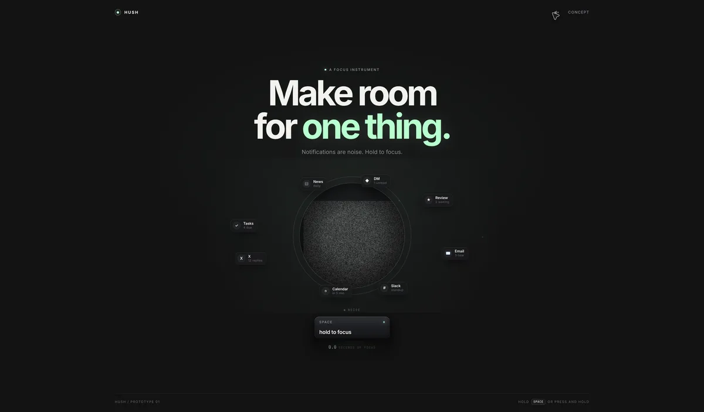
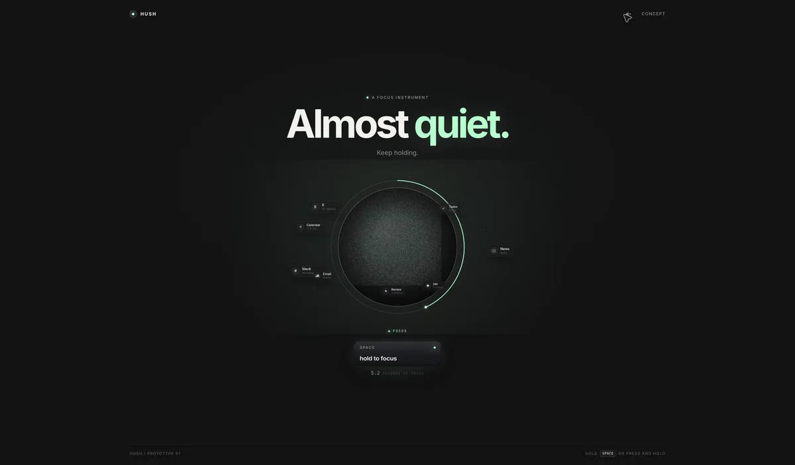
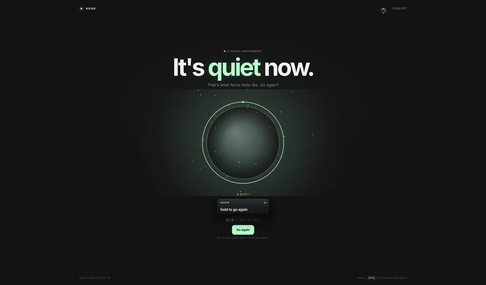

# Hush — a focus instrument (prototype)



Hush is a one-screen interactive hero: a grainy orb, a swarm of notifications, and one gesture.

**Hold `Space`** (or press and hold the keycap). Time slows, the notifications spiral into the orb, the static resolves, and a ring fills. Let go early and the noise rushes back. Hold for twelve seconds and the page blooms into quiet.

The interaction is the product demo: focus is not a toggle, it is something you hold.



## Run it

```bash
npm install
npm run dev
```

Open the URL Vite prints (defaults to `http://127.0.0.1:5173`). Build with `npm run build`.

## What is implemented

- A static-first page: headline, copy, notification chips, keycap, footer.
- A Canvas 2D orb with a procedurally generated noise texture that resolves as focus increases.
- Notification chips that orbit the orb, spiral inward under focus, get absorbed, and respawn.
- A 12-second hold arc with three copy beats: "Stay with it." → "Almost quiet." → "Don't let go." → "It's quiet now."
- A progress ring, absorption particles, ambient dust, and a bloom burst.
- A small synthesized soundscape: a low ambient drone, filtered air, soft absorption chimes, and a bloom chord. It only starts on a user gesture. The header has a mute toggle.
- Reduced-motion support: a static orb, no particles, and a simpler bloom.
- Responsive layout: fewer chips and a smaller stage on phones.
- A dev-only `?test` hook for driving the state without relying on the display refresh rate.



## How it works

- `src/main.ts` owns the state machine (`idle → focusing → done`), the canvas scene, the chip physics, the particle system, and the copy changes.
- `src/audio.ts` is a tiny Web Audio graph: three detuned sine oscillators through a lowpass, a filtered noise layer, a master bus with a compressor, and synthesized chimes/chord. No audio files.
- `src/style.css` is hand-written: a dark stage, a four-layer keycap, glassy notification chips, and responsive rules.

The orb is drawn in CSS pixels on a DPR-scaled canvas. The noise texture is a 256×256 random grayscale image drawn inside a circular clip; its alpha falls as focus rises, while a mint radial gradient takes over. The chips are DOM elements positioned with transforms, so their labels stay crisp.

## Dev hook

Append `?test` to the URL to enable:

```js
document.dispatchEvent(new CustomEvent("hush:start"));
document.dispatchEvent(new CustomEvent("hush:step", { detail: { seconds: 1 / 60, count: 300 } }));
document.dispatchEvent(new CustomEvent("hush:end"));
document.dispatchEvent(new CustomEvent("hush:reset"));
```

`hush:step` advances the simulation deterministically. It is useful for screenshots and for testing the full arc when the tab is in the background.

## Next steps

- Wire the 12-second demo to a real 25-minute timer, with a pause/resume state.
- Add a small settings panel: session length, sound, reduced motion override.
- Make the notifications real: browser notifications, a local API, or a demo feed.
- Add a capture mode (`?capture`) and a poster generator.
- Try a WebGPU orb once the 2D version feels right.
- Add a short manifesto section and a real download/CTA.

## Notes

This is an original prototype built around a few principles: static-first, one diegetic interaction, a physical metaphor, and audio that starts only when you do. No third-party assets, audio, or code are used.

The prototype lives in `hush`. The other prototypes are `morph`, `capture`, `run`, and `wave`.
