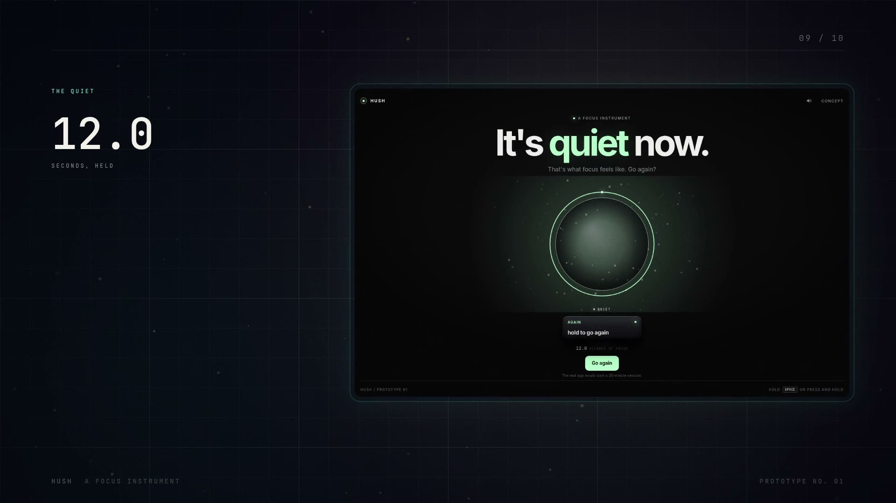

# Hush, explained

**Watch:** [hush-explained.mp4](https://github.com/jimmerioles/hush/releases/download/explainer-v1/hush-explained.mp4) (3:14, 58 MB)

[](https://github.com/jimmerioles/hush/releases/download/explainer-v1/hush-explained.mp4)

A ten-chapter film about Hush, a focus instrument you hold. It follows one held key from noise to quiet, then asks what happens when you let go.

## Chapters

| Time | Chapter | Idea |
| --- | --- | --- |
| 0:00 | The hold | The page is loud before you touch it |
| 0:22 | The noise | Eight chips, eight orbits, no shared clock |
| 0:40 | One gesture | Press and hold, one state machine |
| 0:55 | The pull | One number drives orbit, scale and copy |
| 1:15 | It comes back | Absorption, chime, respawn |
| 1:34 | The static | A 256×256 noise square under a circular clip |
| 1:53 | The clock | The ring and the three copy beats |
| 2:12 | The leak | Twelve seconds to fill, about 1.18 to drain |
| 2:30 | The quiet | 120 particles, an A major bloom, reduced motion |
| 2:50 | One page | 1,717 lines, four files, no image or audio assets |

## The argument

The film is built around the asymmetry in `src/main.ts`: focus climbs at `1 / 12` per second while you hold, and drains at `0.85` per second when you let go. The quiet takes twelve seconds. Losing it takes about one and a fifth. That is why the page is a hold and not a toggle.

Every diagram is driven by the real code:

- The chips use `local = (p - delay) / (1 - delay)`, `pull = smoothstep(local)`, `orbit += pull * 3.4` and `scale = 1 - pull * 0.88`.
- The orb is the actual 256×256 random texture, clipped to a circle. Its alpha falls from `0.32` to `0.048` as focus rises.
- The chime plays from the five-note set in `src/audio.ts`, panned from the side the chip came from.
- The bloom is 120 particles and the A major chord at `220 / 277.18 / 329.63 / 440` Hz.
- The film shows real captures of the page at idle, focusing, late and quiet, taken through the `?test` hook.

## How it is made

- [explainer-kit](https://github.com/jimmerioles/explainer-kit) 1.1.0, the house pipeline.
- 1920×1080, 30 fps, H.264 High@4.1, AAC 192k.
- Voice: Kokoro `af_heart`, speed `0.88`, 24 kHz source, mixed at 48 kHz.
- Score: the house `tech` bed, 100 BPM in A major. Original, deterministic and MIT licensed.
- Master: -16.0 LUFS integrated, -2.8 dBTP true peak.
- Ten chapters, 194.16 seconds, all twelve `verify` gates passed.

The build directory is ignored. The MP4 lives on the [`explainer-v1` release](https://github.com/jimmerioles/hush/releases/tag/explainer-v1), not in Git. The script, scenes, captures, score metadata, golden frame and poster are committed here so the film can be rebuilt.

## Re-render

Start the dev server in one terminal:

```bash
npm run dev
```

Then, from the project root:

```bash
KIT=~/Work/jimmerioles/explainer-kit
node $KIT/bin/explainer.mjs narrate
node $KIT/bin/explainer.mjs capture
node $KIT/bin/explainer.mjs stills
node $KIT/bin/explainer.mjs golden
node $KIT/bin/explainer.mjs render
node $KIT/bin/explainer.mjs mix
node $KIT/bin/explainer.mjs master
node $KIT/bin/explainer.mjs verify
```

The capture URL is `http://127.0.0.1:5173/?test`. The `?test` hook lets the capture script drive the hold deterministically.
